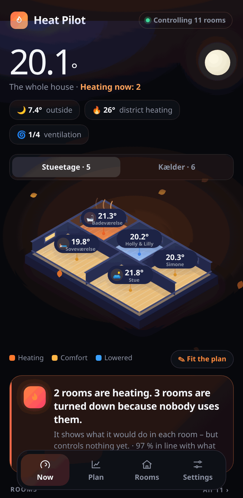
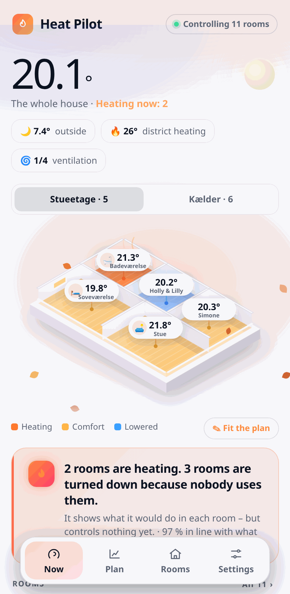
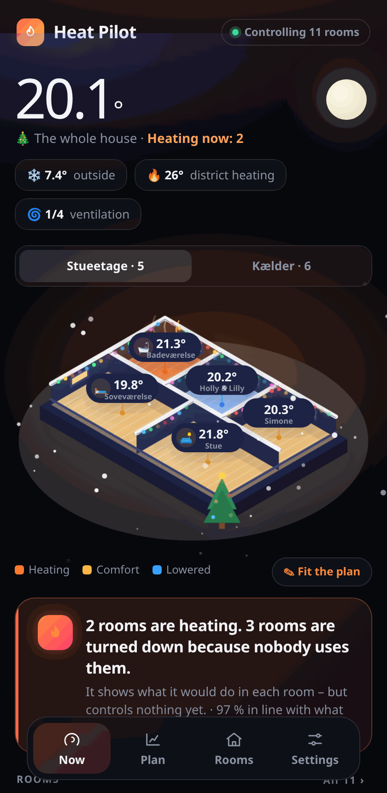
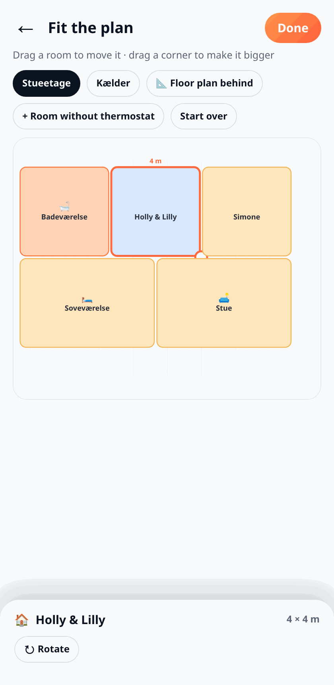
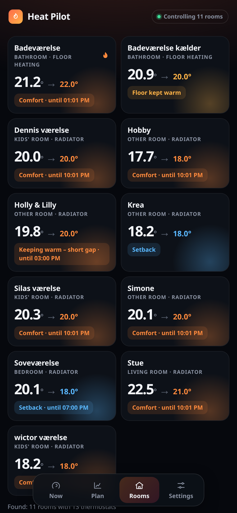

# Heat Pilot · Varmepilot

**Smart heating for every room in Home Assistant – found by itself, in shadow first, as easy as it gets.**

<p align="center">  </p>
<p align="center"> </p>

Heat Pilot finds your rooms, thermostats, room sensors, windows, doors, motion sensors, people, ventilation and
district heating meter by itself, learns how your home is used, and shows what it would do in each room. It
**always starts in shadow**: nothing is sent to a thermostat until you turn control on – room by room.

## What it does

- **Learns when each room is used** – from the last 10 days of motion at once – and how fast each room heats
  (by the weather), so heating **starts in time** and stops when nobody is there.
- **Comfort per room**, evening comfort (e.g. the living room at 22° from 15 to 22), night setback with your own hours.
- **Window open → off. Door open → a little lower. Everyone away → turned down** (motion, the front door, or every
  phone away). On the way home (Proximity) it heats ahead. A child's room follows its person.
- **Holiday** (everyone away for long, or "holiday" in the calendar) and **summer** (heating off after warm days).
- **The sun**: learns which rooms the sun warms and when, and skips heating it would do for free.
- **Room model**: learns how fast each room loses heat – short gaps aren't worth setting back.
- **Strategies**: tries normal, early and gentle heating by itself and keeps the best.
- **District heating**: finds your heat meter (Kamstrup, Danfoss, Landis+Gyr …), shows the cooling and the
  bonus/penalty, and warms gently when cooling is poor.
- **Electric heating and heat pumps** follow the electricity price (same price integrations as Energy Pilot).
- **Ventilation** (Dantherm, Nilan, Genvex, Komfovent, Vallox, Zehnder …): boost after a shower, more air with high
  CO₂/humidity, free cooling – and never heating against it.
- **Warnings**: mould risk, stale air, windows left open, thermostats not responding, low batteries, rooms that
  don't get warm – in the app, and as phone messages only if you want (each kind can be turned off).
- **Turned by hand** is respected, with an echo guard for Zigbee thermostats.
- **The house in 3D**: rooms with walls, windows and wood floors – a warm glow where it heats, a cool blue where it's lowered – floor by floor, with the real weather, night and day, the seasons and the holidays (snow on the walls, Christmas lights and a tree, fireworks, Easter eggs, a pumpkin …).
- **Fit the plan**: drag the rooms to where they are in your home and resize them (25 cm steps, sizes in metres), add rooms without a thermostat such as the hall, and put a picture of your own floor plan faintly behind to trace it. Rooms as thermostat dials, a 48-hour chart per room, a 24-hour plan, a dashboard card and a monthly report.
- **7 languages** (English, Danish, German, French, Dutch, Swedish, Norwegian), **°C and °F**.

## Thermostats

Everything that is a `climate` entity works. The quirks of the common brands are built in, from their integrations'
source and documentation: **Aqara** (E1, W600 – "away" means frost), **SONOFF TRVZB**, **Danfoss Ally** and **Bosch**
(no "off"), **Tuya** valves ("heat" doesn't regulate), **Eurotronic**, **POPP**, **tado°** and **Netatmo** (own
schedules, request limits, manual setpoints that expire), **Homematic IP**, **FRITZ!DECT**, **ecobee**, **Nest**,
**evohome**, **Viessmann**, heat pumps (Daikin, MELCloud, Panasonic, NIBE …) and helpers like Better Thermostat.
Climate groups are skipped (their thermostats are driven directly). A thermostat without a room becomes a room of
its own.

### Help and answers

Press **🛟 Help** (under Settings) to write what's wrong and attach up to 3 pictures. It goes privately to the developer with the diagnostics – only when you press *Send*. When the developer answers – also on an error the app reported – the answer shows under 🛟 Help with a notification in Home Assistant, and you can write back. Errors in the app are sent anonymously so they can be fixed; turn it off under 🛟 Help.

## Install

**Home Assistant OS / Supervised:** Settings → Add-ons → Add-on store → ⋮ → Repositories →
`https://github.com/Clahen86/heat-pilot` → Heat Pilot → Install → Start → open it from the sidebar.

**Docker:**

```
docker build -f docker/Dockerfile -t heat-pilot .
docker run -d --name heat-pilot -p 8099:8099 -v heat-pilot:/data \
  -e HA_URL=http://homeassistant.local:8123 -e HA_TOKEN=<long-lived access token> heat-pilot
```

Then open `http://<host>:8099`. (Add `-v /path/to/ha/config:/homeassistant` to have the dashboard card installed.)

## Tips

- Give your thermostats an **area** (room) in Home Assistant – that's how rooms are found.
- Run it in shadow for a few days and compare. Turn control on room by room in the room's page.
- "Everything back to shadow" (Settings) stops all control at once.
- Something wrong? Download the diagnostics (Rooms tab) – it contains no passwords.

---

**Dansk:** Varme i hvert rum – finder selv rum, termostater, følere, vinduer, personer, ventilation og fjernvarme,
lærer hvordan huset bruges, og starter altid i skygge. Styring slås til rum for rum. Huset vises i 3D med vægge, vinduer og trægulv, og med **Tilpas plan** flytter du rummene, så de passer til din egen plantegning.
